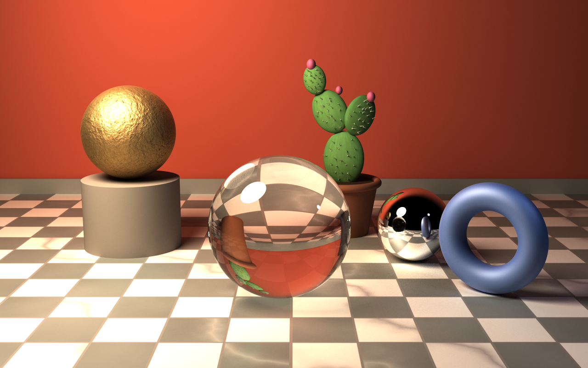

# Still life with cactus



A still life path-traced with [gman](https://github.com/jac18281828/gman), a RenderMan-compatible
renderer. A gold ball sits on a pedestal; a glass ball in front turns the potted prickly pear behind
it upside down, like a lens; a mirror ball and a blue torus stand at the right, on a marble floor
before a clay wall. A warm disk light overhead and a small blue lamp light the scene, and every
bounce between them is traced.

Everything in the frame is generated. Python scripts write the marble floor and the cactus's 16-bit
skin, and a RIB archive builds the cactus itself: four pads, each areole a green cushion with a
white tuft of glochids and a straw spine or two, and three pink buds.

## What you need

- **gman 1.2 or later** on your `PATH`. Download a release tarball from
  [gman's releases](https://github.com/jac18281828/gman/releases), or
  [build it from source](https://github.com/jac18281828/gman#build-from-source).
- **Python 3** with `numpy` and `Pillow`: `pip install numpy Pillow`.
- **make**.

## Render it

```sh
make preview
```

That writes the textures and the cactus under `build/`, then renders `still-life.png` at 640 by 400
with 64 paths through each of four subpixels. It takes about 20 seconds on an Apple M3 Max.

## Render it at high quality

```sh
make hq
```

That renders `still-life-hq.png` at 1920 by 1200 with 512 paths a subpixel, 2,048 a pixel, which
smooths the grain on the floor and in the metal. Expect about 25 minutes on an Apple M3 Max. The
picture above is the same scene at 1280 by 800 with the same sampling.

Two lines at the top of `still-life.rib` set the quality, and `make hq` rewrites both into
`build/still-life-hq.rib`:

```
Format 640 400 1
Option "pathtracer" "integer samples" [64]
```

`Format` sets the size in pixels. `integer samples` sets the paths traced through each subpixel;
`PixelSamples 2 2` makes four subpixels a pixel. Noise falls with the square root of the paths, so
four times the samples halves the grain. Point `make` at a gman outside your `PATH` with
`make hq GMAN=/path/to/gman`.

## What is in it

| File | What it makes |
|---|---|
| `still-life.rib` | The scene: camera, lights, floor, wall and the four objects |
| `gen/marble.py` | `build/marble.tif`, a 2048 by 2048 checkerboard of cream and slate marble |
| `gen/cactus.py` | `build/cactus.tif`, the 16-bit cactus skin, and `build/cactus.rib`, the cactus |
| `images/still-life.png` | The picture above |

## Licence

The code is under the [MIT licence](LICENSE): the scripts under `gen/`, the `Makefile` and any
shader this repository builds. The scene, `still-life.rib`, and the pictures under `images/` are
under [Creative Commons Attribution 4.0](LICENSE-CC-BY-4.0). gman itself is LGPL-2.1-or-later; a
shader here links it as a plugin, and its own code stays MIT.
